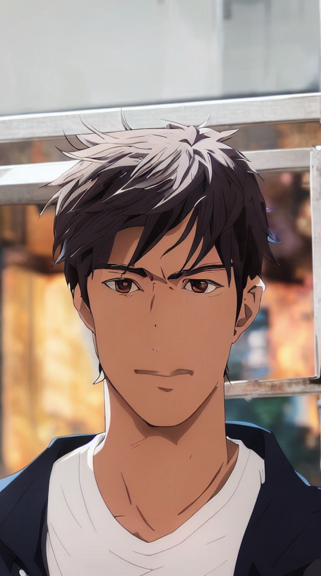
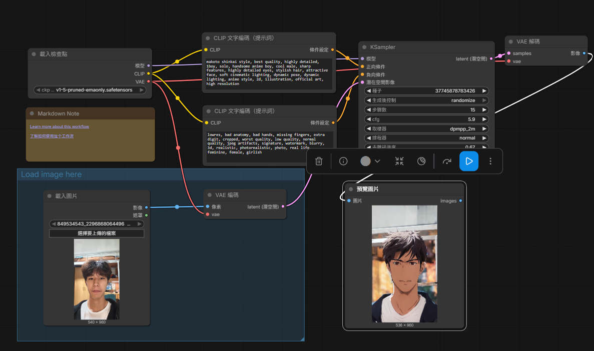
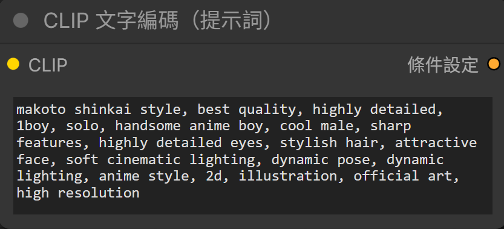
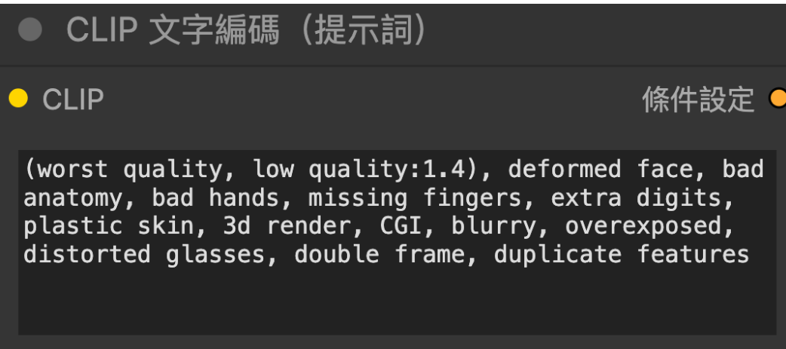

# ComfyUI 圖生圖
# 原圖

# 生成的圖

# 完整工作流截圖

# 正反提示詞
## 正面提示詞
makoto shinkai style, best quality, highly detailed, 1boy, solo, handsome anime boy, cool male, sharp features, highly detailed eyes, stylish hair, attractive face, soft cinematic lighting, dynamic pose, dynamic lighting, anime style, 2d, illustration, official art, high resolution
## 負面提示詞
lowres, bad anatomy, bad hands, missing fingers, extra digit, cropped, worst quality, low quality, normal quality, jpeg artifacts, signature, watermark, blurry, 3d, realistic, photorealistic, photo, real life, feminine, female, girlish

# 個人心得
這次作業使用comfyui的圖生圖功能，讓我搞懂了基礎的圖生圖流程概念。特別是去噪強度如果開太高，原本的畫面結構會整個碎掉；透過反覆調整提示詞跟參數，才終於把圖調到理想的樣子。